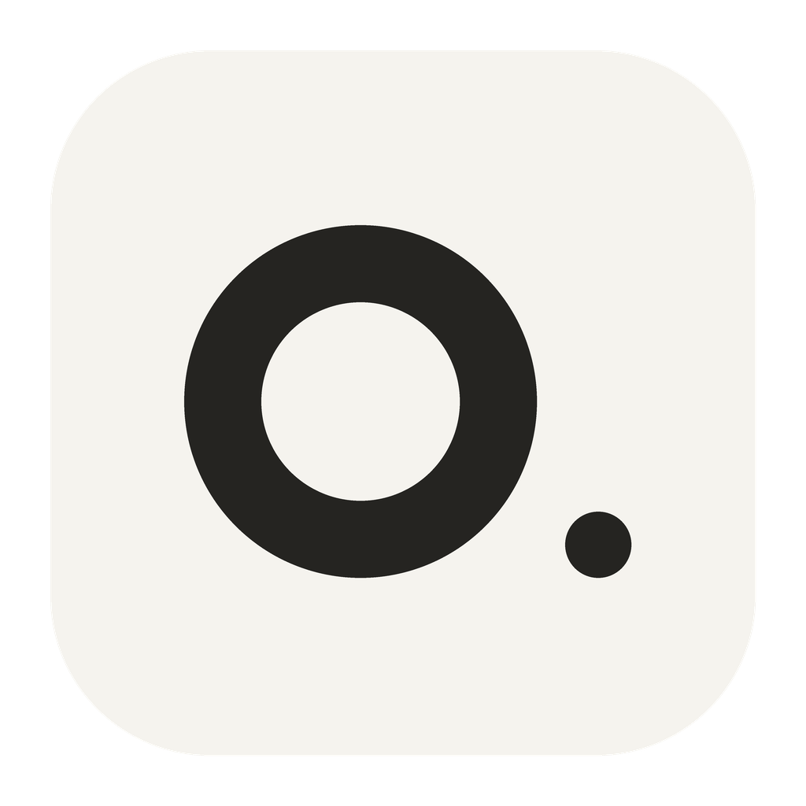
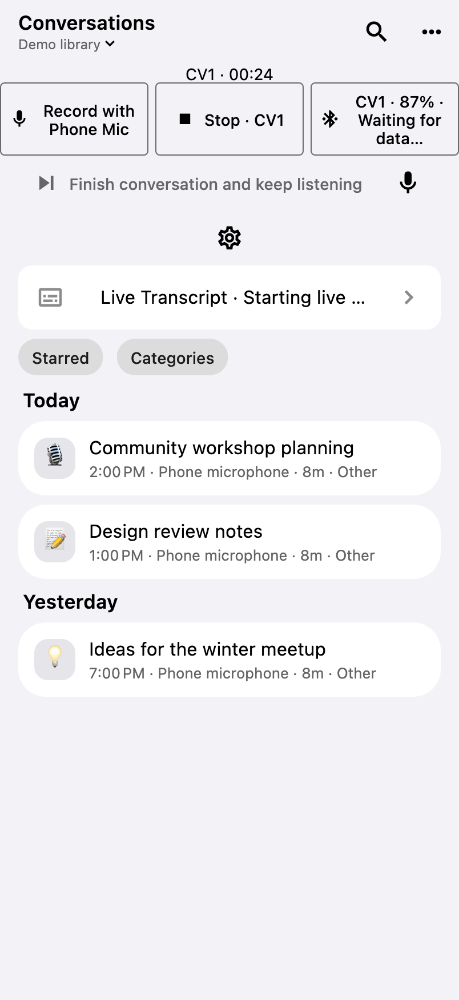
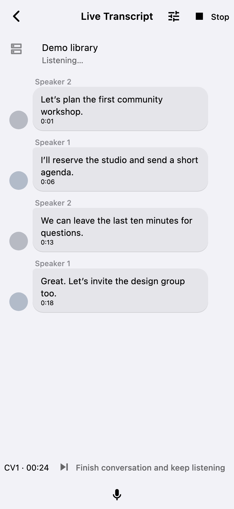
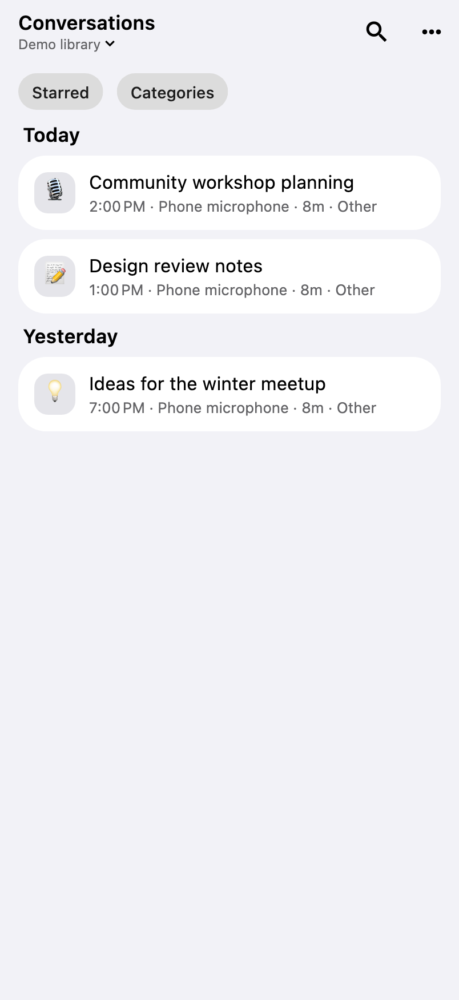
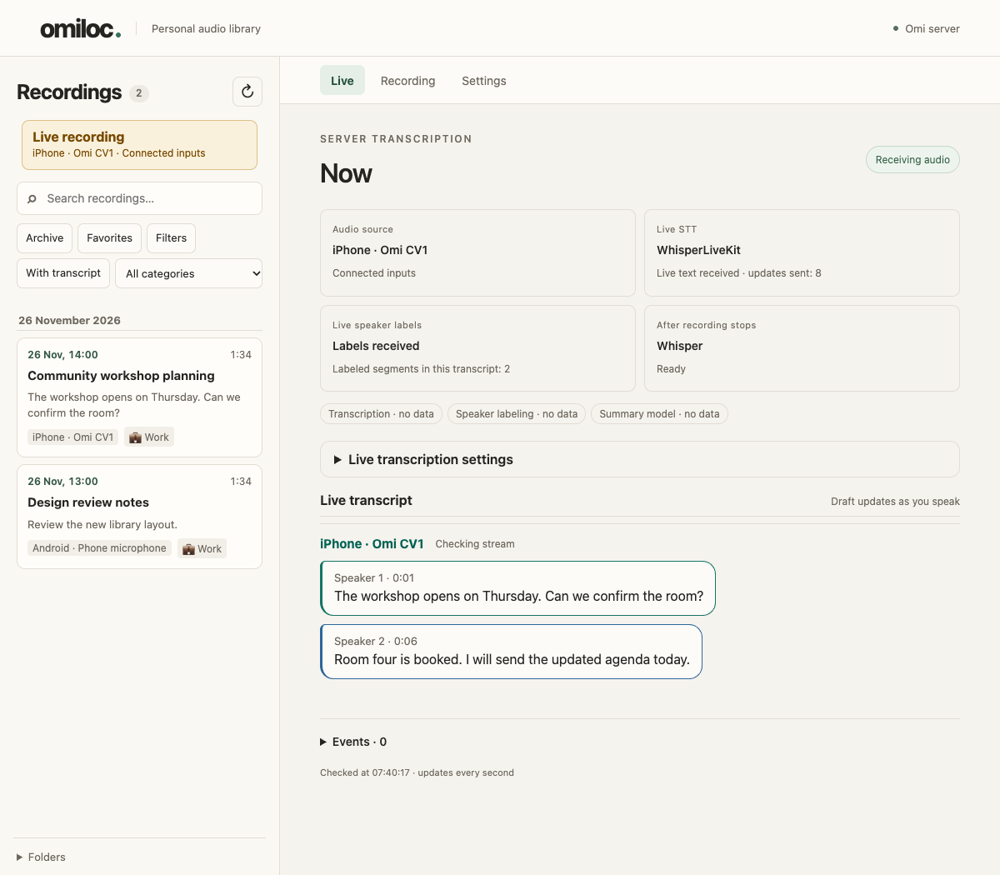
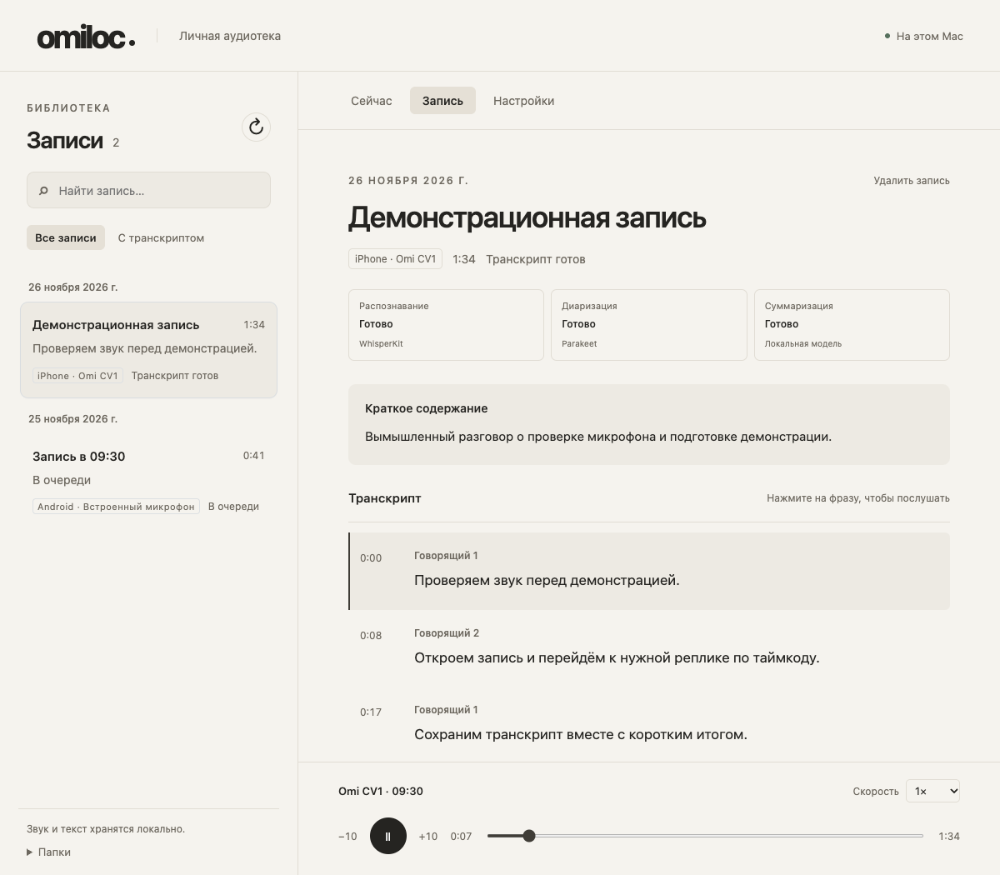

# omiloc

**A personal audio library on your Mac, controlled from your iPhone.**

Record audio from an Omi CV1, browse transcripts, and jump from a transcript
segment to its audio. The iPhone app sends audio through Tailscale or an authenticated ngrok
tunnel. The server keeps the audio library; the phone retains pending audio
locally until the server confirms storage. Processing uses local engines or
explicitly selected servers.

[Mac quick start](#quick-start) · [Docker quick start](#docker-on-cpu-or-nvidia-gpu) · [Development](#development) · [Documentation](#documentation) · [MIT license](LICENSE)

> **Status: local MVP.** Clean-machine installation and recording reliability
> during connection loss are not yet fully verified.

[Omi Local Next](clients/next/README.md#prepare-and-verify) is the primary iOS and Android client for new development. It builds from a pinned Omi Flutter revision. On iPhone it can install alongside the original Omi Local client. Pair either client with the same server to open the same archive. Each iPhone app keeps its own pending uploads. See the [feature comparison and remaining gaps](clients/next/FEATURES.md).

## Features

- **Record from CV1 or the phone mic.** Start, stop and mute from the app, or finish one conversation while keeping CV1 listening. Optional reconnection and auto-start respect an explicit Stop or Mute. Live shows the source, elapsed time, CV1 battery, device identity and connection diagnostics.
- **Keep audio through connection loss.** The mobile outbox retains received audio until the paired server confirms storage. It can deliver ordered parts as one conversation. Next can reopen recent archive cards offline, with audio and full transcripts fetched from the server. See [delivery guarantees and limits](docs/RECORDING_DURABILITY.md).
- **Follow the live transcript.** Browse incoming text without losing your place. Choose speech and silence settings, show speaker labels where supported, and use live translation with a configured provider.
- **Review and share saved recordings.** Search the archive and open the matching transcript. Jump to a timestamp, follow the active line, change playback speed, seek ten seconds at a time, and share audio or text. Edit supported recording fields, name speakers, and organize recordings into folders and emoji categories.
- **See what happened during processing.** The archive shows pending recordings, stage outcomes, and failures with recovery guidance. Retry supported failures from the recording. Configure live transcription, final transcription, diarization and summaries separately.
- **Work with conversations.** Choose summary templates, ask a configured model about a recording or the archive, create tasks with links to source quotes, and work with daily recaps and goals. See the [Next client guide](clients/next/README.md) for server requirements and current limits.
- **Host your own library.** Run on a Mac or with Docker on CPU or NVIDIA GPU. Pair by Tailscale or authenticated ngrok. A standalone WhisperLiveKit deployment can serve up to four configured sessions. The original Local iPhone client remains available for existing workflows.

The [Next feature comparison](clients/next/FEATURES.md) and [migration ledger](clients/next/README.md#migration-ledger) cover implementation details, device checks, and remaining gaps. See the [full Next change history](https://github.com/skywinder/omi-local/compare/329796d...e6ffaa0) for individual commits.

## Screenshots

### Omi Local Next mobile app

The mobile app uses the same screens on iPhone and Android. These examples use the iPhone layout and synthetic demo data.

| Recording | Live transcript | Archive |
| --- | --- | --- |
|  |  |  |

### Web library

The web library shown here is running against synthetic demo data.

| Live monitor | Saved recording |
| --- | --- |
|  |  |

## Requirements

The table below describes the native Mac setup. The [Docker setup](#docker-on-cpu-or-nvidia-gpu)
requires Docker Engine/Desktop and Compose; Python, Java, Node, and Redis run
inside the containers. Installing the iPhone app still requires a Mac with Xcode.

| Component | Requirement |
| --- | --- |
| Mac | Apple Silicon, macOS 14 or later |
| Xcode | Swift 6.0 or later; an iOS SDK compatible with your iPhone |
| iPhone | The local Omi app, installed separately |
| Recording device | Omi CV1 |
| Transport | Tailscale on the server and iPhone; optional ngrok |
| iOS development | Flutter 3.47.4, CocoaPods, and an Apple account for signing |
| Initial setup | Internet access for dependencies and models; at least 4 GiB of free space for model preparation |

The Mac must remain awake while receiving recordings. A free Apple Personal Team
can be used for local signing; see [iPhone setup](docs/LOCAL_SETUP.md) for
provisioning and Developer Mode requirements.

## Quick start

### 1. Start the Mac services

```bash
git clone https://github.com/skywinder/omi-local.git omiloc
cd omiloc
./omiloc bootstrap
./omiloc up
./omiloc open
```

You can also open `start.command` in Finder. The launcher runs the same
`bootstrap`, `up`, and `open` commands:

1. Installs missing Mac dependencies and checks prerequisites.
2. Prepares and verifies WhisperKit for final transcription and Parakeet for live
   preview. The first setup may take several minutes.
3. Discovers the connected Tailscale address and prepares the app key for your
   iPhone; existing ngrok settings remain supported.
4. Starts the services and opens the audio library.

Subsequent launches reuse saved settings and prepared models. Existing engine
choices and explicitly disabled transcription settings are preserved. After
startup finishes, the launcher exits and you can close its terminal window.

See [Getting started](docs/START.md) for the complete installation flow and
[Tailscale setup](docs/TAILSCALE.md) for private `.env` configuration.

### 2. Install and pair the iPhone app

`start.command` prepares the Mac services; install the local iPhone app separately
by following the [iPhone setup guide](docs/LOCAL_SETUP.md).

For prefilled saved servers after installation, prepare a private `.env.servers`
on the Mac that launches the phone app before running `./iphone.command profile`.
The [preset setup](docs/LOCAL_SETUP.md#prefill-saved-servers) sends those settings
only during launch and saves them in Keychain. Keys are never built into the app.
Later launches from the app icon reuse the saved entries; select one and tap
**Check and connect** to activate it.

Run `./omiloc pair` in your own interactive terminal to view the native address
and app key (`./omiloc --runtime docker pair` for Docker).
In the app, open **Local Mac** (**Локальный Mac**), enter that address and key,
and select **Check and connect**. A bare Tailscale IP uses port 20000; Docker uses IP:21000. The app key is separate from
the ngrok authtoken; the authtoken stays on the Mac.

### 3. Record and browse

Connect your CV1 in the iPhone app to start recording automatically. Recording
resumes after a Bluetooth reconnect unless you explicitly stopped or muted it.
The CV1 button and app controls still start/stop recording. The updated app saves
received audio on the phone and uploads parts of at most five minutes to the
paired server. Pending parts remain on the phone until the server acknowledges
them; temporary network failure does not erase them. Saved server parts
remain visible in Conversations while queued, processing, or failed.

After setup, open the library from any directory in Terminal:

```bash
omiloc
```

The [audio library](http://127.0.0.1:20001/) is accessible only on your Mac. Select
a recording to play it, or click a transcript segment to seek to that moment.
New recordings and completed transcripts appear automatically.

The **Now** section, currently labeled **Сейчас**, shows live text, the audio
source, transcription status, and events. Select a recording in the left-hand
list to open its completed transcript and player. See
[Live preview](docs/LIVE_PREVIEW.md) for monitoring and log details.

Use `./start.command` whenever you want to receive new recordings. Use `omiloc`
to browse existing recordings. Do not open `web-local/index.html` directly.

## Docker on CPU or NVIDIA GPU

Install and start Docker Engine or Docker Desktop with Compose **2.32 or later**.
From a new checkout of `main`:

```bash
git clone --branch main https://github.com/skywinder/omi-local.git omiloc
cd omiloc
./omiloc --runtime docker bootstrap --device cpu --transport local
./omiloc --runtime docker up
```

If you already have this repository, run the Docker bootstrap and startup commands
from its root. Open the
[audio library](http://127.0.0.1:21001/). The first launch builds the images and
caches the default `faster-whisper-small` model; later launches reuse them.
`up` waits for readiness and leaves the services running in the background.

To launch directly with Docker Compose, without the CLI, run these commands
from the repository root (CPU on Mac or Linux):

```bash
docker compose -f compose.yaml build app stt download
docker compose -f compose.yaml run --rm --no-deps download
docker compose -f compose.yaml up -d --wait
```

The download step prepares the model before STT starts. For direct GPU startup,
hot reload, logs, and shutdown commands, see
[Using Docker Compose directly](docs/DOCKER.md#using-docker-compose-directly).

| Task | Command |
| --- | --- |
| Prepare or rebuild after updating the code | `./omiloc --runtime docker bootstrap` |
| Develop with Python reload and automatic web refresh | `./omiloc --runtime docker dev` |
| Check container status | `./omiloc --runtime docker status` |
| Follow service logs | `./omiloc --runtime docker logs -f` |
| Stop and keep recordings, settings, and models | `./omiloc --runtime docker down` |

Run `dev` in your own terminal and finish active recordings before backend edits.
When changing between `up` and `dev`, stop the stack with `./omiloc --runtime docker down` first.

Docker uses CPU on Mac. For Linux/WSL2 with a configured NVIDIA GPU runtime:

```bash
./omiloc --runtime docker bootstrap --device cuda --gpu 0 --transport tailscale
./omiloc --runtime docker up
```

Docker bootstrap requires an explicit `cpu` or `cuda` choice. CUDA execution
requires the NVIDIA prerequisites described in the Docker guide and is verified
inside the selected container; there is no silent CPU fallback.
WhisperKit/Core ML uses the [native Mac stack](#quick-start).

The library starts without ngrok. To receive recordings over Tailscale, use
`./omiloc --runtime docker bootstrap --transport tailscale` and pair to **IP:21000**. See
[Docker pairing](docs/DOCKER.md#iphone-through-tailscale); ngrok remains optional. Docker has its own
app key and data volumes; native Mac recordings and settings are not imported.
For upgrades, GPU prerequisites, model selection, and troubleshooting, see the
[Docker guide](docs/DOCKER.md).

## Development

### iPhone launcher

For Omi Local Next, follow the [pinned Flutter setup and acceptance checks](clients/next/README.md#prepare-and-verify), then run:

```bash
python3 clients/next/iphone.py /path/to/omi --install
```

For the original Local client:

```bash
./iphone.command          # choose Debug, Profile, or status
./iphone.command dev      # Omi Local Dev with hot reload
./iphone.command prod     # Omi Local Profile, launched from the app icon
./iphone.command status   # inspect the active session or build
```

`prod` is an alias for the local `profile` mode. Debug installs **Omi Local Dev**
with a `.dev` bundle suffix, alongside **Omi Local**. Each app has its own settings
and Keychain; pair the Dev app separately. Install them one at a time. Profile
exits after installation; end an active Debug session before another launch.
The launcher checks for existing Omi builds and
Flutter sessions across worktrees and refuses a duplicate or an unobservable launch.
Start Mac services separately with `./start.command`.

### Run Debug on an iPhone

Complete the [initial iOS setup](docs/LOCAL_SETUP.md), connect and unlock your
iPhone, enable Developer Mode, and open a terminal in the project directory.
Before a new iOS build, run:

```bash
make test-offline
make test-transport-app
```

Then start the services and app:

```bash
./start.command
./dev-iphone.command
```

If the Mac services are already running, only the second command is needed.
The Debug launcher uses the existing signing and connection settings. It checks
an existing build for reuse or builds again when its inputs change. If prompted,
allow local network access on the iPhone for the debugger.

Wait for **Flutter run key commands** and keep that terminal session open.
After saving Dart changes, press a key without Enter:

| Key | Action |
| --- | --- |
| `r` | Hot reload changes, preserving app state |
| `R` | Hot restart Dart and reset app state |
| `v` | Open Flutter DevTools |
| `h` | Show available commands |
| `q` | End the debug session and stop the app |

Saving a file alone does not apply changes. Swift, native-plugin, and build-setting
changes require restarting the build workflow. Update dependencies and generated
files as described in the iOS guide before rebuilding when needed.

Launch Debug through the script. Use a Profile build for everyday launches from
the app icon. To check Debug prerequisites without building or installing:

```bash
./dev-iphone.command --check
```

Run only one Flutter session for the app at a time. For interactive hot reload,
start the command in your own terminal after any previous session has ended.
See [Development](docs/DEVELOPMENT.md) for build verification and additional tests.

## Known limitations

- This standalone snapshot focuses on the local iPhone/CV1 workflow. Upstream
  cloud features and deployments are outside its scope.
- Storage is local; selected remote processing providers and ngrok audio transport
  require a network connection.
- Live preview is experimental. Final transcription runs after recording ends.
- The iPhone microphone is available through the app's **+** control. Switching
  inputs finishes the previous recording while preserving the Bluetooth connection.
- Starting capture after an app restart requires an authenticated check of the
  updated server. After that check, received packets are retained during temporary
  server outages and retried. See [delivery and recovery](docs/RECORDING_DURABILITY.md).
- Continuous BLE capture through iOS suspension/termination, background upload
  availability, physical interruption recovery, long-session reliability and
  clean-machine setup still require fresh device evidence.

See [Current limitations](docs/TEMPORARY_DISABLED_FEATURES.md) for details.

## Troubleshooting

Run these commands from the project directory:

| Problem | First step |
| --- | --- |
| Docker services are unavailable | `./omiloc --runtime docker status`, then `./omiloc --runtime docker logs` |
| Mac services or transcription are unavailable | `./omiloc doctor`, then `./omiloc logs` |
| iPhone tools, signing, or device readiness fail | `./iphone.command --check` |
| `omiloc` is not found | Run `./omiloc --install`, then open a new terminal |
| Setup was interrupted | Run `./start.command` again to resume preparation |
| The phone cannot connect | Follow [Connection diagnostics](docs/CONNECTION_DIAGNOSTICS.md) |
| You need to stop the Mac services | `./omiloc down` |

Setup output is saved in `.local/install.log`. Keep recordings, logs, app keys,
ngrok credentials, and signing files private.

## Documentation

The guides below are in English. Some interface labels and the synthetic Russian
speech fixture retain their original text.

| Guide | Topics |
| --- | --- |
| [Docker](docs/DOCKER.md) | CPU/GPU runtime, development reload, and container storage |
| [Getting started](docs/START.md) | Installation, daily use, and recovery |
| [iPhone setup](docs/LOCAL_SETUP.md) | Tools, signing, and app installation |
| [Tailscale](docs/TAILSCALE.md) | Direct IP pairing, native/Docker ports, and private configuration |
| [Ngrok](docs/NGROK.md) | Optional HTTPS tunnel and pairing |
| [Connection diagnostics](docs/CONNECTION_DIAGNOSTICS.md) | Investigating phone-to-Mac connectivity |
| [Recording delivery](docs/RECORDING_DURABILITY.md) | Phone pending audio, acknowledged uploads and recovery limits |
| [Repository plan](docs/REPOSITORY_PLAN.md) | Implemented improvements and remaining acceptance gates |
| [Transcription](docs/LOCAL_STT.md) | Preparing and running local engines |
| [WhisperKit migration](docs/WHISPERKIT_MIGRATION.md) | Switching final ASR while preserving diarization, live providers and history |
| [Providers](docs/PROVIDERS.md) | Live STT, final transcription, diarization, and summaries |
| [Live preview](docs/LIVE_PREVIEW.md) | Experimental live text and diagnostics |
| [Development](docs/DEVELOPMENT.md) | Tests, builds, hot reload, and verification |
| [Current limitations](docs/TEMPORARY_DISABLED_FEATURES.md) | Supported features and verification limits |
| [Security and recovery](docs/SECURITY.md) | Network boundaries, dependency checks and archive recovery |

## Contributing

Read [AGENTS.md](AGENTS.md) and the relevant component guide before changing code.
Use the standalone repository's commands, add regression tests for bug fixes,
and describe your verification in the pull request. Remove secrets and personal
recording content from reports.

## License and acknowledgements

Licensed under the [MIT License](LICENSE). Based on
[Omi by Based Hardware](https://github.com/BasedHardware/omi).
See [UPSTREAM.md](UPSTREAM.md) for the snapshot's origin and retained notices.
